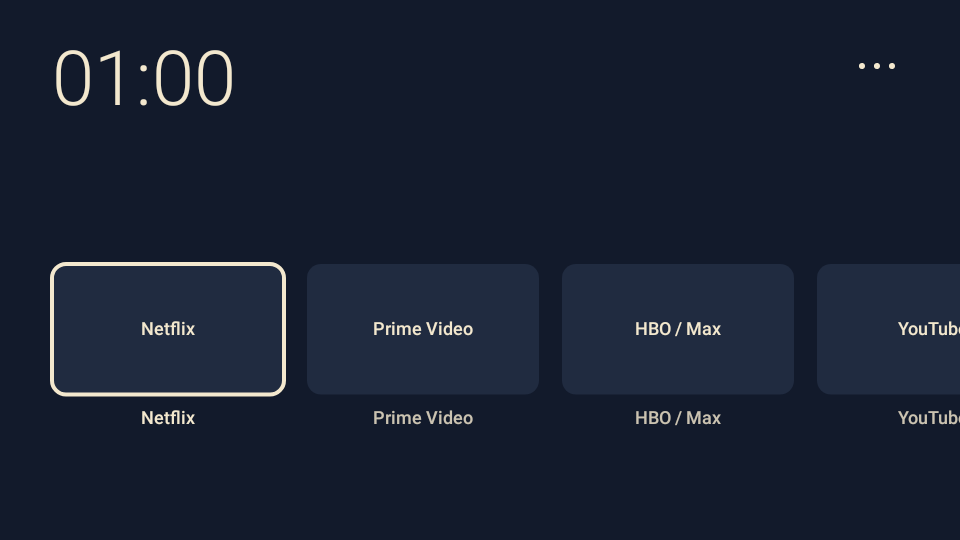

# MiStick Lite 1.2.0 — wynik budowania, 30 października 2026

Przygotowano eksperymentalne przekierowanie krótkiego HOME(3), po fizycznym potwierdzeniu przez użytkownika w 1.1.0, że MiTV-AESP0 / Android 9 / PI.2055 dostarcza tej usłudze HOME DOWN i UP. Wersja 1.2.0 pozostaje **OFF po instalacji/aktualizacji i każdej nowej sesji usługi**. Nie włączono jej na urządzeniu.

## Artefakt i narzędzia

| Metryka | Wynik |
| --- | --- |
| APK debug | `../MiStickLite-1.2.0-debug.apk` oraz alias `../MiStickLite-debug.apk` |
| Application ID | `pl.misticklite` |
| Wersja / kod | 1.2.0 / 3 |
| SDK | min 28, target 28, compile 35 |
| APK | **167 063 B** (163,1 KiB) |
| DEX | 138 496 B, 136 klas, 975 wpisów metod |
| SHA-256 APK | `9a97239b3b0188f2d2a2354dc0145b1774450d9a7f6ea0acef042a9efbd1dfe8` |
| Podpis | APK Signature Scheme v2, poprawny |
| Certyfikat SHA-256 | `9c696c62fa2d5d1ca557f82cf76ba00671eda4d65042a20f6f94413660601d6c` |
| zipalign | poprawny |
| Nowe zależności wykonawcze | brak |

Ten sam certyfikat co w 1.0.0/1.1.0 umożliwia aktualizację przez `install -r`. Nie ma żądanego INTERNET, WRITE_SECURE_SETTINGS, roota ani nowego procesu. DUMP chroni debugowy receiver, a BIND_ACCESSIBILITY_SERVICE chroni usługę; nie są to żądania `uses-permission` dla aplikacji.

Użyto istniejącego Temurin JDK 17.0.21+9, Gradle 8.7, AGP 8.6.1, Kotlin 1.9.25, SDK platform 35 i Build Tools 34.0.0 z `work/toolchain/`. Bez instalacji narzędzi systemowych. Gradle/testy działały z `--offline`; dodatkowe uprawnienie środowiska było potrzebne do lokalnych gniazd TCP procesów build/test. Wariant debug korzysta z R8 do usuwania nieużywanego kodu, przy zachowaniu ograniczeń optymalizacji/obfuskacji dla debuggable.

## Walidacja

```sh
scripts/build-local.sh --offline assembleDebug testDebugUnitTest lintDebug assembleRelease lintRelease
python3 -m unittest discover -s scripts -p test_service_memory.py
```

**BUILD SUCCESSFUL. 50/50 testów Android/JVM i 11/11 testów Python. Lint debug i release: No issues found.** Po testach ponownie zapakowano ten sam kod debug bez pozostałości po pakowaniu przyrostowym; potem sprawdzono podpis, wyrównanie i metadane końcowego APK.

| Zestaw | Liczba | Główne sprawdzenia |
| --- | ---: | --- |
| CatalogOrderTest | 7 | kolejność, ukrycie, reinstalacja, brak limitu ośmiu |
| HomeBehaviorTest | 7 | DPAD, fokus, przewijanie, trzy pozycje menu, render |
| HomeKeyDiagnosticServiceTest | 7 | domyślna diagnostyka, metadata bez okien, brak historii i zmian ustawień |
| HomePressRouterTest | 15 | pełne pary, przełączanie w gestach, long/repeat/cancel, double, dwa urządzenia, brak narastającej historii |
| HomeRedirectIntegrationTest (tylko testDebug) | 14 | flags/startActivity, foreground guard, błędy, status/receiver DUMP, OFF po reconnect, zamknięcie tylko UI i bezpieczne disable-service |
| Narzędzie PSS, unittest | 11 | parser Android 9, brak procesu, mediany, odrzucanie niezamkniętego UI, status przed/po, odrzucenie zmiany trybu w próbce |

Przy OFF usługa przepuszcza 3/284. Przy ON przechwytuje wyłącznie pełne pary HOME(3). Start występuje tylko po krótkim UP, z jawnym komponentem i `NEW_TASK | SINGLE_TOP | CLEAR_TOP`; MainActivity nadal ma `singleTask`. Na już wznowionym pulpicie nie ma dodatkowego startu. Powtórzenia nie uruchamiają aktywności. Szybki podwójny Home daje jedną próbę startu. Błąd RuntimeException przełącza OFF, bez automatycznych ponowień.

DOWN/UP są latched per bieżący gest: OFF w trakcie pary anuluje start i konsumuje końcowe UP; ON po przepuszczonym DOWN nie przechwytuje UP. Osierocone zdarzenia nie są claimowane. Zwykłe disable-service odmawia odłączenia, jeśli pozostaje skonsumowana para, i prosi o zwolnienie Home. Nagłe zabicie procesu lub utrata zdarzenia przez firmware nie mogą być naprawione przez aplikację; ograniczenie jest opisane w procedurze.

**Debug/release:** skompilowany manifest debug zawiera receiver chroniony DUMP. Skompilowany manifest release i jego DEX nie zawierają HomeRedirectDebugReceiver. Release został zbudowany i przeszedł lint, ale nie jest dostarczany jako podpisane wydanie produkcyjne ani jako wariant do tego eksperymentu. W release przekierowanie jest dodatkowo zablokowane przez BuildConfig.DEBUG=false.

## Pulpit i aplikacje bez zmian

Sumy plików MainActivity, HomeViews, AppCatalog, ArtworkLoader, CatalogOrder, OrderStore, SystemScreens oraz stylów i grafik są identyczne jak w 1.1.0. Render z tymi samymi przykładowymi aplikacjami jest **identyczny bajt po bajcie**. Nie zmieniono wyglądu, kolejności aplikacji ani menu.

Nowa MiStickApplication rejestruje w debug wyłącznie callbacki cyklu życia własnej aktywności. Kontroler używa słabych referencji, aby wykryć już widoczny pulpit i umożliwić debugowe finish() dla pomiaru. Nie odczytuje ekranu ani aktywności innych aplikacji. Brak nowych wątków/timerów i trwałego zapisu trybu.

## Instrukcja, PSS i granice potwierdzenia

- **[HOME-REDIRECT-1.2.md](HOME-REDIRECT-1.2.md):** dokładne polecenia status/enable/disable, ręczne ustawienia dostępności, test ze streamingu, ograniczenia długiego/podwójnego Home oraz awaryjne wyłączenie tylko naszego komponentu przez ADB.
- **[MEMORY-REPORT.md](MEMORY-REPORT.md):** close-launcher bez force-stop, potwierdzenie CLOSED, PSS usługi w wspólnym procesie przy zamkniętym pulpicie i porównanie trybu OFF/ON.

PSS na urządzeniu **niezmierzony**. Nie instalowano APK na TV, nie zmieniano domyślnego HOME ani ustawień urządzenia, nie wyłączano i nie odinstalowywano com.google.android.tvlauncher. Fizyczne działanie przekierowania 1.2 ze streamingu, długiego/podwójnego Home i awaryjnego powrotu wymaga testu przez właściciela. Potwierdzenie callbacków 1.1 nie jest deklaracją, że te scenariusze 1.2 już przeszły na sprzęcie.

Długi Home przy ON jest spójnie konsumowany i nie otwiera MiStick Lite, ale oryginalna akcja długiego Home nie zostaje zachowana. Nie da się najpierw skonsumować początkowego DOWN, a później przekazać systemowi kompletnego oryginalnego długiego gestu bez dodatkowego mechanizmu odtwarzania; takiego mechanizmu nie implementowano. OFF przywraca normalny strumień kolejnych par.

Dowody w `validation/`: build i pakowanie, XML testów, unittest Python, lint obu wariantów, podpis, zipalign, manifesty obu wariantów, uprawnienia i badging końcowego APK, porównanie źródeł, podsumowanie JSON i mapowanie R8. Prywatnego klucza debug nie ma w archiwum; pozostaje w work/toolchain/.android/debug.keystore.


