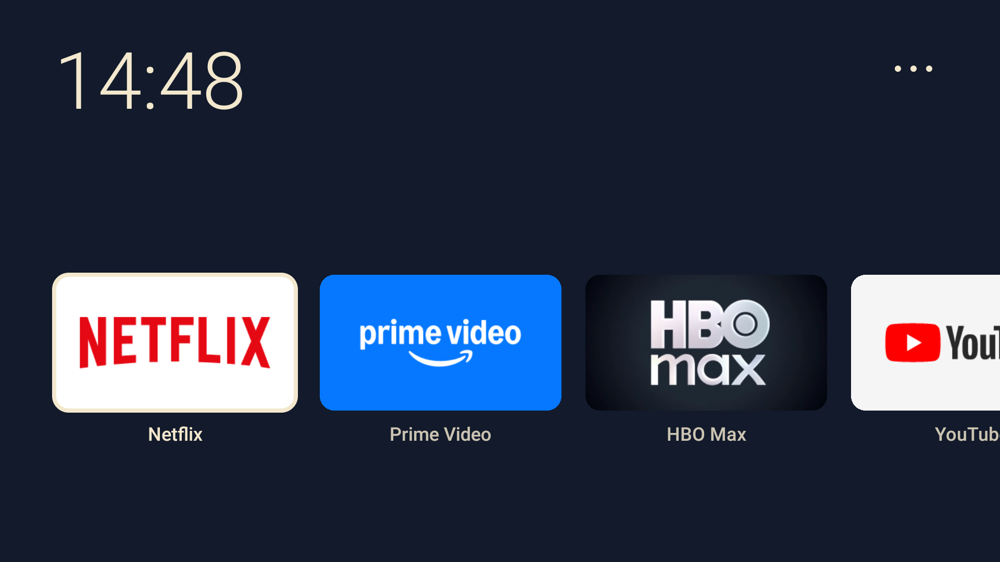

# MiStick Lite

**Lekki, minimalistyczny launcher dla Android TV.**

MiStick Lite to natywny launcher Android TV zaprojektowany z myślą o urządzeniach z ograniczoną pamięcią RAM, szczególnie **Xiaomi Mi TV Stick Full HD**.

Zamiast rozbudowanego ekranu głównego, rekomendacji i reklam otrzymujesz prosty pulpit: duży zegar, jeden poziomy rząd aplikacji i minimalistyczne menu obsługiwane pilotem.

**Aktualna wersja:** 1.2.0  
**Platforma:** Android TV 9+ (minimalne API 28)  
**Technologia:** Kotlin + Android Views  
**Licencja:** MIT



## Najważniejsze funkcje

- Minimalistyczny interfejs w ciemnych granatowych i kremowych kolorach.
- Duży zegar `HH:mm` w lewym górnym rogu.
- Jeden poziomy rząd aplikacji.
- Brak reklam i rekomendacji w launcherze.
- Automatyczne wykrywanie zainstalowanych aplikacji.
- Możliwość zmiany kolejności i ukrywania kafelków.
- Pełna obsługa pilotem Android TV.
- Proste menu: **Konto, Ustawienia, Sklep z aplikacjami**.
- Natywne Android Views, bez Jetpack Compose.
- Brak rozbudowanych bibliotek UI i bibliotek do ładowania obrazów.
- Lokalne zapamiętywanie kolejności i ukrytych aplikacji.

## Pobieranie APK

**[GitHub Releases — pobierz MiStick Lite](https://github.com/TheKowallab/MiStickLite/releases)**

Pierwsze publiczne wydanie APK jest w przygotowaniu. Do czasu opublikowania wydania aplikację można skompilować z kodu źródłowego.

MiStick Lite można zainstalować przez ADB bez rootowania urządzenia.

**Uwaga dotycząca aktualizacji:** kompilacje debug są podpisywane lokalnym kluczem debug. Aktualizacja istniejącej instalacji wymaga zgodności podpisu. Przyszłe wydanie podpisane kluczem produkcyjnym może wymagać odinstalowania wcześniejszej wersji debug, co usuwa lokalne ustawienia aplikacji.

## Sprawdzona kompatybilność

Projekt został fizycznie przetestowany na:

| Parametr | Urządzenie testowe |
|---|---|
| Producent | Xiaomi |
| Model | Mi TV Stick Full HD |
| Identyfikator | MiTV-AESP0 |
| System | Android TV 9 |
| API | 28 |
| Firmware | PI.2055 |
| Pamięć RAM | Około 1 GB |
| Pamięć wewnętrzna | 8 GB |

Na tym urządzeniu potwierdzono uruchamianie launchera, obsługę pilota, przełączanie aplikacji oraz działanie jako ekran Home po ponownym uruchomieniu systemu przy odpowiedniej konfiguracji.

**Działanie na innych urządzeniach Android TV nie zostało potwierdzone.** W szczególności nazwy pakietów systemowych i zachowanie przycisku Home mogą różnić się pomiędzy producentami i wersjami firmware.

## Wygląd i obsługa pilota

Interfejs wykorzystuje:

- Tło: `#121A2B`
- Kolor tekstu i zaznaczenia: `#F3E8CE`
- Zegar w formacie `HH:mm`
- Jeden poziomy, przewijany rząd zaokrąglonych kafelków
- Kremową ramkę wskazującą aktualnie zaznaczony kafelek

### Sterowanie

| Przycisk | Działanie |
|---|---|
| Lewo / prawo | Przejście pomiędzy aplikacjami |
| OK | Uruchomienie zaznaczonej aplikacji |
| Góra | Przejście do menu trzech kropek |
| Dół z menu | Powrót do ostatniego kafelka |
| Wstecz na pulpicie | Powrót do pierwszego kafelka |
| Przytrzymanie OK na aplikacji | Zmiana kolejności lub ukrycie aplikacji |
| Przytrzymanie OK na trzech kropkach | Lista ukrytych aplikacji i ich przywracanie |

Menu trzech kropek zawiera dokładnie:

1. **Konto**
2. **Ustawienia**
3. **Sklep z aplikacjami**

Nie ma osobnej pozycji „Wszystkie aplikacje”.

### Domyślna kolejność aplikacji

Przy pierwszym uruchomieniu launcher preferuje następującą kolejność:

1. Netflix
2. Prime Video
3. HBO / Max
4. YouTube
5. SkyShowtime
6. TVP VOD
7. Pilot WP
8. Apple TV

Wyświetlane są wyłącznie aplikacje rzeczywiście zainstalowane i dostępne do uruchomienia.

Pozostałe aplikacje znajdują się dalej w tym samym rzędzie. Nowo zainstalowane aplikacje trafiają na koniec listy.

Kolejność i informacje o ukrytych aplikacjach są zapisywane lokalnie w `SharedPreferences`. Aktualizacja przez `adb install -r` zasadniczo zachowuje te dane, natomiast odinstalowanie MiStick Lite je usuwa.

## Instalacja przez ADB

### 1. Przygotowanie

Potrzebujesz:

- Komputera z Android Platform Tools (`adb`).
- Xiaomi Mi TV Stick lub innego zgodnego urządzenia Android TV.
- Włączonych opcji programisty i debugowania ADB.
- Działającego, autoryzowanego połączenia ADB.
- Pliku APK MiStick Lite.

Korzystaj wyłącznie z zaufanej sieci lokalnej.

Na komputerze sprawdź dostępne urządzenia:

```bash
adb devices -l
```

Jeżeli urządzenie ma już skonfigurowane debugowanie ADB przez sieć, połącz się:

```bash
adb connect ADRES_IP_STICKA:5555
adb devices -l
```

Adres IP zastąp rzeczywistym adresem urządzenia. Port `5555` musi być dostępny i wcześniej skonfigurowany — nie każde urządzenie udostępnia ADB przez sieć domyślnie.

Dalsze przykłady zakładają jedno połączone urządzenie.

### 2. Sprawdzenie urządzenia

Przed jakimikolwiek zmianami sprawdź model i system:

```bash
adb shell getprop ro.product.model
adb shell getprop ro.build.version.sdk
adb shell getprop ro.build.display.id
```

Zapisz także stan fabrycznego ekranu Home i wyłączonych pakietów.

Jeśli korzystasz z kodu źródłowego projektu, możesz użyć skryptu diagnostycznego:

```bash
sh scripts/adb-snapshot.sh ADRES_IP_STICKA:5555
```

Skrypt służy do zebrania informacji o urządzeniu; sprawdź jego zawartość i wyniki przed dalszymi operacjami.

### 3. Zainstalowanie aplikacji

Przejdź w terminalu do katalogu zawierającego pobrany APK.

Przykładowo:

```bash
adb install -r MiStickLite-1.2.0-debug.apk
```

Jeżeli APK został zbudowany lokalnie w katalogu projektu, użyj:

```bash
adb install -r app/build/outputs/apk/debug/app-debug.apk
```

Nazwa pliku musi odpowiadać rzeczywiście pobranej lub zbudowanej wersji.

### 4. Pierwsze uruchomienie

Uruchom MiStick Lite:

```bash
adb shell am start -W -n pl.misticklite/.MainActivity
```

Sprawdź działanie zegara, kafelków, pilota, menu trzech kropek oraz uruchamiania aplikacji.

**Samo zainstalowanie i uruchomienie MiStick Lite nie powoduje automatycznego zastąpienia fabrycznego launchera.**

## Ustawianie MiStick Lite jako domyślnego Home

**Ta sekcja opisuje zaawansowaną, opcjonalną konfigurację.**

Zmiany pakietów systemowych mogą spowodować utratę dostępu do pulpitu lub innych funkcji Android TV. Nie wykonuj ich bez działającego połączenia ADB i możliwości przywrócenia poprzednich ustawień.

Nie odinstalowuj pakietów systemowych.

### Przetestowana konfiguracja Xiaomi MiTV-AESP0

Na urządzeniu testowym fabryczny launcher występował jako:

```text
com.google.android.tvlauncher
```

Przed zmianami upewnij się, że dokładnie ten pakiet odpowiada za fabryczny ekran Home na Twoim urządzeniu.

Po przetestowaniu MiStick Lite jako zwykłej aplikacji na egzemplarzu testowym wykonano:

```bash
adb shell pm disable-user --user 0 com.google.android.tvlauncher
```

Po tej zmianie system kierował przycisk Home do MiStick Lite.

**Ważne:** na części urządzeń ta operacja może nie zadziałać, może zostać zablokowana przez system albo pozostawić użytkownika bez działającego pulpitu. Nie traktuj jej jako uniwersalnej instrukcji dla wszystkich telewizorów.

### Problem z przywracaniem fabrycznego launchera po restarcie

Na przetestowanym Xiaomi MiTV-AESP0 z firmware PI.2055 zaobserwowano, że fabryczny launcher potrafił zostać ponownie włączony podczas uruchamiania systemu.

Na tym konkretnym egzemplarzu problem ustąpił po wyłączeniu:

```text
com.google.android.tungsten.setupwraith
```

Pakiet ten uczestniczy w konfiguracji systemu.

**Nie zaleca się wyłączania SetupWraith jako standardowego kroku instalacji.** Zmiana może wpłynąć na proces konfiguracji Android TV, Wi-Fi lub inne funkcje systemowe. Na innych urządzeniach skutki mogą być odmienne.

Wyłącznie w ramach zaawansowanej diagnostyki identycznego urządzenia, po przygotowaniu procedury odzyskiwania, na testowanym egzemplarzu zastosowano:

```bash
adb shell pm disable-user --user 0 com.google.android.tungsten.setupwraith
```

Po tej zmianie i wyłączeniu fabrycznego launchera MiStick Lite uruchamiał się jako ekran Home również po restarcie.

## Przywracanie oryginalnego Android TV

Jeżeli wcześniej wyłączono fabryczny launcher albo SetupWraith, można spróbować przywrócić je przez ADB:

```bash
adb shell pm enable --user 0 com.google.android.tvlauncher
adb shell pm enable --user 0 com.google.android.tungsten.setupwraith
```

Następnie uruchom urządzenie ponownie:

```bash
adb reboot
```

Sprawdź, czy fabryczny ekran Home i funkcje systemowe działają prawidłowo.

Jeżeli dodatkowo wyłączono pakiety rekomendacji lub diagnostyki Xiaomi, można je przywrócić, o ile występują na danym urządzeniu i były wcześniej aktywne:

```bash
adb shell pm enable --user 0 com.google.android.tvrecommendations
adb shell pm enable --user 0 com.miui.tv.analytics
```

Nie uruchamiaj tych poleceń bez potrzeby. Przywracaj tylko pakiety, których stan rzeczywiście zmieniono.

**Uwaga:** jeżeli urządzenie utraci połączenie ADB przez sieć, odzyskanie kontroli może być utrudnione. Przed wyłączeniem jakichkolwiek pakietów systemowych upewnij się, że masz realną możliwość odzyskania dostępu do urządzenia.

## Eksperymentalne przekierowanie przycisku Home

Wersja 1.2.0 zawiera dodatkowy, eksperymentalny mechanizm diagnostyczny:

`HomeKeyDiagnosticService`

Mechanizm jest domyślnie wyłączony.

Pozwala testować przechwytywanie krótkiego naciśnięcia przycisku Home przez usługę dostępności, ale wymaga osobnego włączenia i konfiguracji debugowej.

Nie jest potrzebny, gdy Android TV prawidłowo rozpoznaje MiStick Lite jako domyślny launcher.

W trybie eksperymentalnym nie gwarantuje się zachowania oryginalnej akcji długiego naciśnięcia Home.

Szczegółowa dokumentacja:

[HOME-REDIRECT-1.2.md](HOME-REDIRECT-1.2.md)

## Wydajność i wykorzystanie pamięci RAM

MiStick Lite zaprojektowano z myślą o ograniczeniu obciążenia starszych urządzeń Android TV.

Rozwiązania zastosowane w projekcie:

- Natywny interfejs Android Views.
- Brak Jetpack Compose.
- Brak ciągłego odpytywania listy aplikacji.
- Skanowanie aplikacji poza głównym wątkiem interfejsu.
- Ładowanie grafik przede wszystkim dla widocznych i sąsiednich kafelków.
- Ograniczenie pamięci podręcznej obrazów do 3 MiB.
- Brak sieciowych reklam i rekomendacji w launcherze.

Kafelki korzystają z bannerów lub ikon już zainstalowanych aplikacji. Duże grafiki są skalowane przed wykorzystaniem.

### Pomiar pamięci

Na podłączonym urządzeniu uruchom:

```bash
adb shell dumpsys meminfo pl.misticklite
```

Można również sprawdzić ogólny stan pamięci systemu:

```bash
adb shell cat /proc/meminfo
```

Oraz listę procesów:

```bash
adb shell top -n 1 -m 15
```

Na testowanym Xiaomi zaobserwowano zużycie PSS launchera rzędu około **16 MiB** w określonych warunkach pomiarowych.

Nie jest to gwarantowane zużycie pamięci na każdym urządzeniu ani deklaracja stałej oszczędności RAM. Wynik zależy między innymi od uruchomionych procesów, liczby aplikacji i aktualnego stanu systemu.

Dokumentacja pomiarów:

[MEMORY-REPORT.md](MEMORY-REPORT.md)

## Opcjonalna optymalizacja Android TV

Na niektórych urządzeniach można poprawić subiektywną płynność interfejsu przez ograniczenie czasu animacji systemowych.

Przykład ustawienia skali animacji na `0.5`:

```bash
adb shell settings put global window_animation_scale 0.5
adb shell settings put global transition_animation_scale 0.5
adb shell settings put global animator_duration_scale 0.5
```

Przywrócenie domyślnych wartości `1.0`:

```bash
adb shell settings put global window_animation_scale 1.0
adb shell settings put global transition_animation_scale 1.0
adb shell settings put global animator_duration_scale 1.0
```

Ta zmiana nie zwiększa fizycznej ilości RAM ani mocy procesora. Zmienia jedynie czas trwania animacji.

Nie zaleca się masowego wyłączania usług systemowych bez uprzedniego sprawdzenia ich funkcji.

Po zakończeniu konfiguracji warto wyłączyć debugowanie ADB, jeżeli nie jest już potrzebne.

## Budowanie ze źródeł

Projekt można zbudować lokalnie na komputerze.

### Wymagania

- JDK 17
- Android SDK Platform 35
- Android SDK Build Tools 34.0.0
- Gradle 8.7 — wrapper dołączony do projektu
- Android Gradle Plugin 8.6.1
- Kotlin 1.9.25

Parametry aplikacji:

| Parametr | Wartość |
|---|---|
| applicationId | `pl.misticklite` |
| minSdk | 28 |
| targetSdk | 28 |
| compileSdk | 35 |

`compileSdk 35` oznacza wersję Android SDK wykorzystaną do kompilacji, a nie minimalną wymaganą wersję Androida.

`targetSdk 28` nie oznacza zgodności z aktualnymi wymaganiami publikacji nowych aplikacji w Google Play. Projekt jest obecnie przeznaczony do dystrybucji poza sklepem i instalacji przez ADB.

### Kompilacja debug APK

Skonfiguruj JDK 17 i Android SDK.

W głównym katalogu projektu uruchom:

```bash
sh ./gradlew --no-daemon assembleDebug
```

Wynikowy APK:

```text
app/build/outputs/apk/debug/app-debug.apk
```

Jeśli Gradle nie wykrywa SDK, skonfiguruj zmienną `ANDROID_HOME` lub utwórz lokalny plik `local.properties` z wpisem:

```properties
sdk.dir=/pelna/sciezka/do/android-sdk
```

Nie publikuj `local.properties` w repozytorium, ponieważ zawiera ścieżkę specyficzną dla danego komputera.

### Testy i lint

```bash
sh ./gradlew --no-daemon testDebugUnitTest lintDebug
```

W raportowanej weryfikacji wersji 1.2.0 wykonano:

- 50 testów Android/JVM.
- 11 testów narzędzia diagnostycznego pamięci.

Łącznie: **61 testów**.

Dodatkowe testy narzędziowe:

```bash
python3 -m unittest discover -s scripts -p test_service_memory.py
```

Wyniki kompilacji i testów opisano w:

[BUILD-REPORT.md](BUILD-REPORT.md)

### Podpisywanie wydań

APK debug jest podpisywany kluczem debug.

Wydania przeznaczone do publicznej dystrybucji powinny być podpisywane osobnym, bezpiecznie przechowywanym kluczem wydawcy.

**Nigdy nie publikuj prywatnego klucza podpisu, hasła do keystore ani plików z danymi dostępowymi.**

## Architektura aplikacji

MiStick Lite wykorzystuje natywny interfejs Android Views oraz mechanizmy systemowe Androida.

### Wykrywanie aplikacji

Launcher wyszukuje aktywności obsługujące:

- `ACTION_MAIN + LEANBACK_LAUNCHER`
- `ACTION_MAIN + LAUNCHER`

Pierwszeństwo mają aktywności przeznaczone dla Android TV.

Aplikacja pomija własny pakiet, niedostępne aktywności i punkty wejścia, których nie można prawidłowo uruchomić.

Lista aplikacji jest aktualizowana między innymi przy powrocie na pulpit oraz po instalacji, aktualizacji lub usunięciu pakietów.

Nie jest wymagane ciągłe skanowanie systemu.

### Grafiki aplikacji

Launcher wykorzystuje grafiki udostępniane przez zainstalowane aplikacje.

Rozmiary próbkowanych obrazów ograniczono do:

- Banner: maksymalnie 384 × 216 px.
- Ikona: maksymalnie 128 × 128 px.

Pamięć podręczna LRU grafik ma limit 3 MiB. Limit ten nie oznacza całkowitego zużycia RAM przez proces aplikacji.

### Przechowywanie danych

Kolejność kafelków i ukryte aplikacje są zapisywane lokalnie przez `SharedPreferences`.

Launcher nie korzysta z chmury do synchronizacji tych ustawień.

## Testowanie i diagnostyka

Przed uznaniem urządzenia za zgodne zaleca się sprawdzenie:

- Prawidłowego wyświetlania pulpitu i zegara.
- Obsługi wszystkich podstawowych przycisków pilota.
- Przejścia przez długi rząd aplikacji.
- Uruchamiania dostępnych aplikacji streamingowych.
- Menu Konto, Ustawienia i Sklep z aplikacjami.
- Zmiany kolejności kafelków.
- Ukrywania i przywracania aplikacji.
- Wykrywania nowych i usuwanych pakietów.
- Zachowania ustawień po ponownym uruchomieniu aplikacji.
- Działania przycisku Home.
- Zachowania systemu po restarcie urządzenia.
- Możliwości bezpiecznego przywrócenia fabrycznego launchera.
- Wykorzystania pamięci RAM i stabilności aplikacji.

Testowanie domyślnego ekranu Home i eksperymentalnej usługi dostępności to dwie odrębne procedury.

Nie wyłączaj pakietów systemowych tylko po to, aby przetestować zachowanie nieobsługiwanych ekranów.

## Dokumentacja projektu

- [Raport kompilacji i testów](BUILD-REPORT.md)
- [Raport dotyczący pamięci](MEMORY-REPORT.md)
- [Eksperymentalna obsługa przycisku Home](HOME-REDIRECT-1.2.md)
- [Strona projektu](docs/index.html)
- [Kod aplikacji](app/src/main/)
- [Skrypty pomocnicze](scripts/)

## Bezpieczeństwo

MiStick Lite jest niezależnym projektem open source.

Autor nie gwarantuje poprawnego działania na wszystkich urządzeniach Android TV.

Przed wprowadzeniem zmian systemowych:

- Sprawdź dokładny model i wersję firmware.
- Zapisz stan fabrycznego launchera.
- Upewnij się, że ADB działa.
- Przygotuj procedurę przywracania.
- Nie odinstalowuj pakietów systemowych.
- Nie wyłączaj nieznanych komponentów Androida.
- Wykonuj zmiany na własną odpowiedzialność.

Wyłączenie fabrycznego launchera lub SetupWraith może powodować problemy z urządzeniem. Czynności przetestowane na Xiaomi MiTV-AESP0 nie powinny być bezpośrednio przenoszone na inne modele.

## Licencja

Kod źródłowy MiStick Lite jest udostępniany na warunkach licencji **MIT**.

Szczegóły znajdują się w pliku [LICENSE](LICENSE).

Projekt nie jest powiązany z Xiaomi, Google, Netflix, Amazon, HBO, SkyShowtime, Apple ani innymi producentami urządzeń i usług.

Nazwy i znaki towarowe należą do ich odpowiednich właścicieli. Licencja MIT na kod projektu nie obejmuje cudzych znaków towarowych.

---

**MiStick Lite 1.2.0**  
Minimalistyczny Android TV Launcher  
Projekt: [TheKowallab](https://github.com/TheKowallab)
